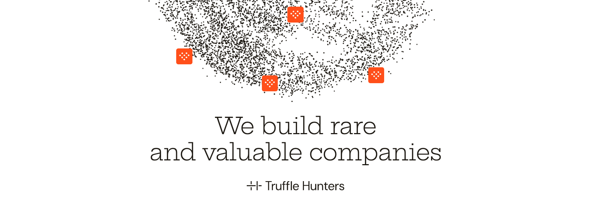

  <a href="https://trufflehunters.com.br/en">
    <picture>
      <source media="(prefers-color-scheme: dark)" srcset="https://raw.githubusercontent.com/truffle-hunters/.github/main/profile/assets/banner-dark.png">
      
    </picture>
  </a>

**Truffle Hunters is a Spinoff Studio based in Brasília, Brazil.** We build businesses adjacent to established companies from untapped value, giving rise to new, scalable companies.

We specialize in adjacency strategy and early-stage companies. We explore the assets a company already commands and the opportunities in the market to create business models with a clear competitive edge, and we build the new revenue engine with the obsession of a co-founder.

## How we build

| Stage | What it does |
| --- | --- |
| **1. Design** | Find the business worth building |
| **2. Build** | Build the product that puts the thesis to the test |
| **3. GTM & Growth** | Win customers and grow the business |

[See how the Spinoff Studio works](https://trufflehunters.com.br/en/servicos)

## Portfolio

| Business | What it is |
| --- | --- |
| [**LicitaCred**](https://trufflehunters.com.br/en/cases/licitacred) | Credit infrastructure for public-sector suppliers, with credit analysis based on the government buyer |
| [**Sight**](https://trufflehunters.com.br/en/cases/sight) | Behavior analysis, management alerts and recommendations from computer vision on the security cameras retail chains already have |
| [**Omuna**](https://trufflehunters.com.br/en/cases/omuna) | A living health record: appointments, tests and habits in one continuous, secure and private history |
| [**Trya**](https://trufflehunters.com.br/en/cases/trya) | Lower claims ratios for corporate health plans and employee well-being management, with care that comes before the emergency room |
| [**Scilog**](https://trufflehunters.com.br/en/cases/scilog) | Autonomous drone transport of biological and hospital materials, with route data recorded on blockchain |

[See all cases](https://trufflehunters.com.br/en/cases)

## Corporate innovation services

- [Innovation Strategy](https://trufflehunters.com.br/en/servicos/estrategia-de-inovacao)
- [Adjacency Map](https://trufflehunters.com.br/en/servicos/mapa-de-adjacencias)
- [Revenue Architecture](https://trufflehunters.com.br/en/servicos/arquitetura-de-receita)
- [AI-First Operations](https://trufflehunters.com.br/en/servicos/operacao-ai-first)
- [Market Validation](https://trufflehunters.com.br/en/servicos/prova-de-mercado)
- [Business Case](https://trufflehunters.com.br/en/servicos/business-case)
- [GTM Plan](https://trufflehunters.com.br/en/servicos/plano-de-gtm)
- [Product Development](https://trufflehunters.com.br/en/servicos/desenvolvimento-de-produto)

## Get in touch

Tell us about your company at [trufflehunters.com.br](https://trufflehunters.com.br/en/contato) or write to [contato@trufflehunters.com.br](mailto:contato@trufflehunters.com.br).

[Website](https://trufflehunters.com.br/en) · [About](https://trufflehunters.com.br/en/sobre) · [LinkedIn](https://www.linkedin.com/company/h4ndslab/) · [Instagram](https://www.instagram.com/bytrufflehunters/)

Truffle Hunters is a Brazilian company and is not related to the 2020 documentary The Truffle Hunters.
